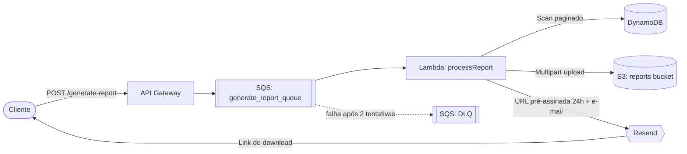
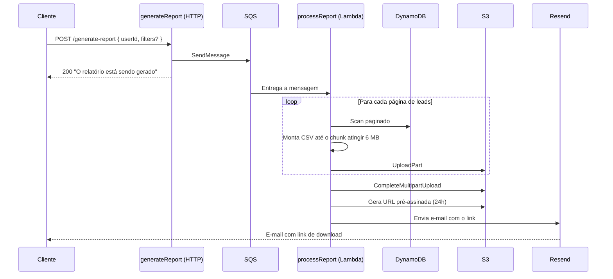

# Async Report Generator

Gerador assíncrono de relatórios CSV em larga escala, construído com **AWS Lambda**, **SQS** e **S3**. Ele percorre os leads do DynamoDB em chunks, envia o relatório para o S3 via **multipart upload** e o entrega ao usuário por e-mail com uma **URL pré-assinada** de curta duração usando o **Resend**.

<p align="left">
  
  
  
  
  
  
  
</p>

## Como funciona



O fluxo é totalmente assíncrono — a requisição HTTP retorna imediatamente e o trabalho pesado acontece em background:



**Pontos-chave:**

| Aspecto            | Descrição                                                                                                          |
| ------------------ | ------------------------------------------------------------------------------------------------------------------ |
| Desacoplamento     | A requisição é desacoplada do processamento via **SQS**, mantendo a resposta rápida.                               |
| Uso de memória     | O CSV é montado de forma incremental e enviado em partes de no mínimo **6 MB** (mínimo do multipart do S3 é 5 MB). |
| Download seguro    | A URL de download é **pré-assinada e válida por 24 horas**.                                                        |
| Lifecycle do S3    | O bucket **apaga os objetos após 1 dia** e aborta multipart uploads incompletos após 1 dia.                        |
| Tolerância a falha | A fila possui uma **dead-letter queue** (`maxReceiveCount: 2`, retenção de 14 dias) para mensagens com falha.      |

## Tech stack

| Categoria     | Tecnologias                                                                 |
| ------------- | --------------------------------------------------------------------------- |
| **Runtime**   | Node.js 24 (ARM64), TypeScript (strict)                                     |
| **Infra**     | Serverless Framework v4, esbuild                                            |
| **AWS**       | Lambda, API Gateway (HTTP API), SQS (+ DLQ), DynamoDB, S3                   |
| **Libraries** | AWS SDK v3, [Zod](https://zod.dev), [Resend](https://resend.com), [faker](https://fakerjs.dev) |
| **Tooling**   | pnpm, Biome, Husky + lint-staged, Commitlint (conventional + gitmoji)       |

## Setup

### Pré-requisitos

- **Node.js** 24+
- **pnpm** 11+
- Conta **AWS** com credenciais configuradas (ex.: `aws configure`)
- Uma **API key** do [Resend](https://resend.com)

### 1. Instale as dependências

```bash
pnpm install
```

### 2. Configure as variáveis de ambiente

```bash
cp .env.example .env
```

Preencha o arquivo `.env`:

| Variável         | Descrição                            |
| ---------------- | ------------------------------------ |
| `RESEND_API_KEY` | API key usada para enviar o e-mail.  |

> As demais variáveis (`LEADS_TABLE`, `GENERATE_REPORT_QUEUE_URL`, `REPORTS_BUCKET_NAME`) são injetadas no deploy a partir dos recursos provisionados.

### 3. Faça o deploy

```bash
pnpm dlx serverless deploy
```

> O deploy é feito na região `sa-east-1` por padrão (configurável no `serverless.yml`).
